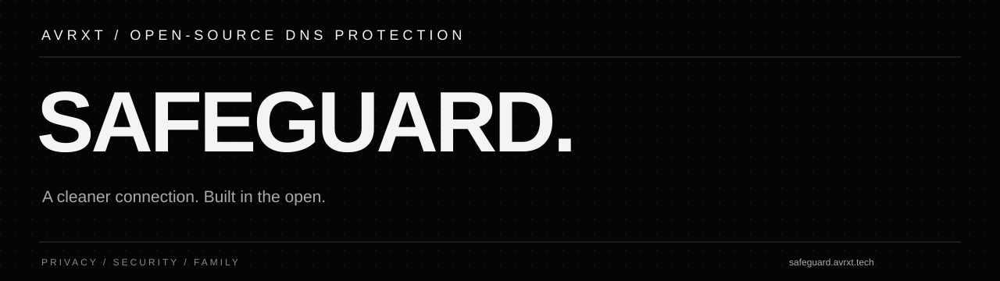

<p align="center"><a href="https://safeguard.avrxt.tech"></a></p>

<p align="center">
<a href="https://github.com/aviorxt/safeguard/actions/workflows/update.yml"></a>
<a href="https://github.com/aviorxt/safeguard/actions/workflows/ci.yml"></a>
<a href="https://github.com/aviorxt/safeguard/actions/workflows/check.yml"></a>
<a href="LICENSE"></a>
</p>

<p align="center"><b>Open-source DNS blocklists for privacy, security and family protection.</b><br>Daily updates. Transparent sources. Formats for popular DNS resolvers.</p>

<p align="center"><a href="https://safeguard.avrxt.tech">Website</a> · <a href="#subscriptions">Subscriptions</a> · <a href="COMPATIBILITY.md">Compatibility</a> · <a href="CONTRIBUTING.md">Contribute</a> · <a href="https://github.com/aviorxt/safeguard/issues/new/choose">Report an issue</a></p>

## Choose your protection

| Profile | Includes | Subscription |
| :--- | :--- | :--- |
| **Family** | Ads, trackers, threat domains and adult content | [AdGuard](https://safeguard.avrxt.tech/blocklists/family.txt) · [Pi-hole / domains](https://safeguard.avrxt.tech/blocklists/family-domains.txt) |
| **Standard** | Ads, trackers and threat domains | [AdGuard](https://safeguard.avrxt.tech/blocklists/standard.txt) · [Pi-hole / domains](https://safeguard.avrxt.tech/blocklists/standard-domains.txt) |

**Family includes Standard. Choose one combined profile.** Add optional categories only when you need them; gambling, social-network restrictions and device-specific lists are not automatically added to either profile.

```text
https://safeguard.avrxt.tech/blocklists/family.txt
```

Use the [website](https://safeguard.avrxt.tech/#categories) to select a format and copy its URL in one click. Import the URL into your resolver and keep subscription refresh enabled. See the [compatibility guide](COMPATIBILITY.md) for setup details.

## Subscriptions

| Category | Group | Coverage | Subscribe |
| :--- | :--- | :--- | :--- |
| **Ads & trackers** | Security | Balanced advertising, tracking and unwanted-domain filtering. | [Get URL](https://safeguard.avrxt.tech/#categories) |
| **Threat protection** | Security | Threat-intelligence domains covering malware, phishing, scams and cryptomining. | [Get URL](https://safeguard.avrxt.tech/#categories) |
| **Adult content** | Content | Adult-content domain filtering. | [Get URL](https://safeguard.avrxt.tech/#categories) |
| **Gambling** | Content | Size-optimized gambling-domain restrictions. | [Get URL](https://safeguard.avrxt.tech/#categories) |
| **Social networks** | Content | Restrictions for classic social-network domains. | [Get URL](https://safeguard.avrxt.tech/#categories) |
| **Windows & Office** | Devices | Microsoft ecosystem telemetry and native tracking domains. | [Get URL](https://safeguard.avrxt.tech/#categories) |
| **Apple** | Devices | Native tracking domains in the Apple ecosystem. | [Get URL](https://safeguard.avrxt.tech/#categories) |
| **Samsung** | Devices | Native tracking domains used by Samsung devices. | [Get URL](https://safeguard.avrxt.tech/#categories) |
| **Xiaomi** | Devices | Native tracking domains used by Xiaomi devices. | [Get URL](https://safeguard.avrxt.tech/#categories) |
| **OPPO & Realme** | Devices | Native tracking domains for OPPO and Realme devices. | [Get URL](https://safeguard.avrxt.tech/#categories) |
| **Amazon devices** | Devices | Native tracking domains across Amazon devices and services. | [Get URL](https://safeguard.avrxt.tech/#categories) |
| **Smart TV** | Devices | Combined LG webOS and Roku native tracking domains. | [Get URL](https://safeguard.avrxt.tech/#categories) |
| **Cryptomining** | Security | Known mining domains from NoCoin. | [Get URL](https://safeguard.avrxt.tech/#categories) |
| **Phishing** | Security | Domain-only phishing intelligence from the Phishing URL Blocklist. | [Get URL](https://safeguard.avrxt.tech/#categories) |
| **Malware** | Security | Malware-distribution domains from the URLhaus-derived feed. | [Get URL](https://safeguard.avrxt.tech/#categories) |

Content restrictions are opt-in. Device lists may affect diagnostics or connected features. Category overlap is normal; adding every list does not necessarily improve protection.

## Supported formats

| Format | Intended consumers | Family download |
| :--- | :--- | :--- |
| Adblock DNS | AdGuard Home and compatible DNS-filter importers | [family.txt](https://safeguard.avrxt.tech/blocklists/family.txt) |
| Domains | Pi-hole, Blocky, Technitium and other domain-list importers | [family-domains.txt](https://safeguard.avrxt.tech/blocklists/family-domains.txt) |
| Hosts | Hosts-compatible filters and operating-system hosts files | [family-hosts.txt](https://safeguard.avrxt.tech/blocklists/family-hosts.txt) |
| dnsmasq | Local-zone configuration include | [family-dnsmasq.conf](https://safeguard.avrxt.tech/blocklists/family-dnsmasq.conf) |
| Unbound | `server:` configuration include | [family-unbound.conf](https://safeguard.avrxt.tech/blocklists/family-unbound.conf) |
| RPZ | BIND and resolvers with compatible RPZ support, including PowerDNS Recursor | [family-rpz.zone](https://safeguard.avrxt.tech/blocklists/family-rpz.zone) |

Every category is available in all six formats. Import support and matching behavior depend on the resolver/version. Hosted DNS services without custom-list imports cannot subscribe directly. [Read compatibility details →](COMPATIBILITY.md)

## Sources and updates

Safeguard combines maintained community intelligence from **HaGeZi**, **NoCoin**, **Phishing URL Blocklist**, and the **URLhaus-derived filter**. Source attribution, license notices and verbatim snapshots are preserved. We do not claim independent discovery of every domain.

- [Source manifest](sources.json) and [source snapshots](sources/)
- [Reviewed domain supplements](rules/README.md) for confirmed advertising gaps and explicit family-policy domains
- [Category catalog](catalog.json) and [build report](https://safeguard.avrxt.tech/blocklists/report.json)
- [Daily update status](https://github.com/aviorxt/safeguard/actions/workflows/update.yml) and [publication checks](https://github.com/aviorxt/safeguard/actions/workflows/check.yml)
- [Changelog](CHANGELOG.md)

Updates are normalized, deduplicated and validated before publication. Failed downloads, suspicious count reductions or validation errors stop publishing and preserve the last successful lists. Invalid hostnames in selected hosts feeds are excluded with an audit record; unsupported rule syntax is not silently widened. The build report records counts, hashes and exclusions.

## Contributing

Fork the repository, create a focused branch, and submit a pull request with the supplied template. Include what changed, why, tests and any migration/rollback steps. Read [CONTRIBUTING.md](CONTRIBUTING.md) before editing rules or adding sources.

Use an [issue form](https://github.com/aviorxt/safeguard/issues/new/choose) for false positives, missed threats, bugs, source requests or migrations. For repository/subscription changes, see [MIGRATION.md](MIGRATION.md). Do not post credentials, private client IDs, personal browsing URLs or private logs.

## Limits and support

DNS lists cannot inspect HTTPS paths, remove same-domain video ads, enforce Safe Search by themselves, or guarantee complete protection. False positives and missed threats are possible. Keep resolver protections such as DNSSEC and Safe Search configured separately.

Contact: **dns@avrxt.tech**. Sensitive vulnerabilities: [SECURITY.md](SECURITY.md).

## License

GPL-3.0, with preserved MIT source notices and font OFL notices. AVRXT-authored code and modifications are GPL-3.0-or-later. See [LICENSE](LICENSE), [NOTICE](NOTICE), and [licenses/](licenses/). Provided without warranty.

### Suggest a domain

Use the [community submission page](https://safeguard.avrxt.tech/update-list) to choose a category and prepare a GitHub request. Submit from your own account. Maintainer-approved requests pass validation before the lists change, and published contributions retain your GitHub credit.

See the [community contributor credits](CONTRIBUTORS.md) and [published contributions](https://safeguard.avrxt.tech/update-list#recent). Accepted submissions include the contributor, domain, category, date, and original request.
